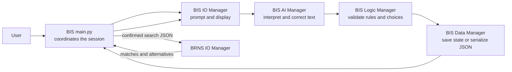
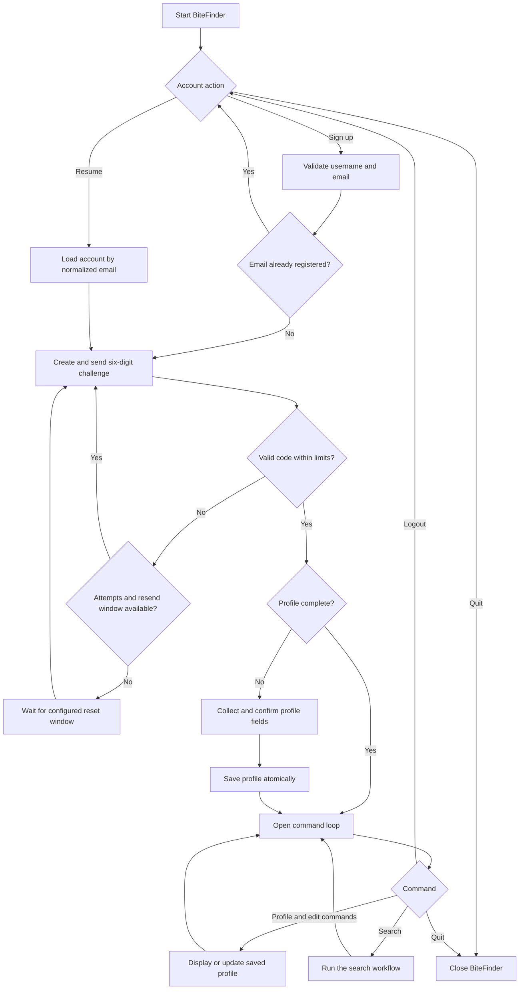
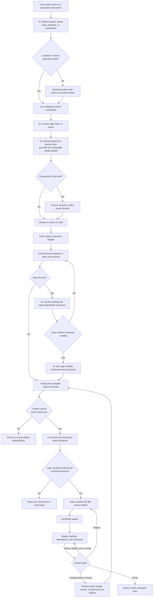

# BIS — BiteFinder Interaction System

BIS is BiteFinder's account, profile, command, and search-input application. It
owns the interactive CLI, validates what the user confirms, persists reusable
preferences, and hands one structured JSON search request to BRNS.

Run BIS from the repository root:

```bash
python main.py
```

The root launcher imports `BIS.main`. Direct execution also works:

```bash
python BIS/main.py
```

In Docker Compose, use:

```bash
docker compose exec bis-brns python BIS/main.py
```

## Responsibilities

BIS is responsible for:

- signup and account resume by email;
- six-digit SMTP verification and attempt-window handling;
- reusable profile creation and editing;
- slash commands and supported natural-language commands;
- terminal colors saved per account;
- today's location, travel, cuisine, budget, dietary, and special-request
  collection;
- AI-assisted spelling, interpretation, equivalence, and hard-constraint
  detection;
- confirmation before corrected or interpreted text is used;
- validation and serialization of the exact request sent to BRNS;
- post-search menus, including repeat, refine, sort, route, details, and email;
- saving confirmed new cuisines and special requests for later searches.

BIS does not search Google Places, rank restaurants, verify MUIS certificates,
or calculate routes itself. Those responsibilities belong to BRNS and BRC.

## Manager flow



`main.py` coordinates this flow. AI output never writes directly to a profile;
I/O confirmation and Logic validation occur before Data saves the update.

## Files

| Path | Purpose |
| --- | --- |
| `main.py` | Account loop, session loop, command dispatch, search orchestration, and result actions |
| `io_manager.py` | All BIS terminal prompts and displays, account selection, profile input, search collection, and result menus |
| `ai_manager.py` | BIS-owned provider chain, prompts, JSON parsing, response validation, spelling review, command interpretation, and search interpretation |
| `logic_manager.py` | Profile updates, cuisine conflict checks, location rules, search validation, and required `evaluate`, `score`, and `route` interfaces |
| `data_manager.py` | Account registry, profile state, atomic JSON writes, shared geocoding cache access, and search serialization |
| `sources/profile_schema.py` | Canonical profile fields, accepted cuisines, normalization, types, and value validation |
| `sources/prompts.py` | Profile questions, command help, labels, AI intents, and prompt text |
| `support/config.py` | Root `.env` loading and BIS configuration validation |
| `support/email_verification/challenge.py` | Verification-code hashing, expiry, resend, and attempt-window rules |
| `support/email_verification/email_delivery.py` | SMTP verification and Maps-link delivery |
| `support/email_verification/service.py` | Challenge persistence and interactive verification service |
| `data/users.json` | Local account and preference registry; ignored by Git |
| `data/profile_state.json` | Verification, first-search, and display state; ignored by Git |

## Account and verification flow

1. The account menu asks the user to sign up, resume, or quit.
2. Signup validates a unique normalized email and a username from 1–50
   characters.
3. Resume loads the account associated with the normalized email.
4. When SMTP bypass is disabled, BIS creates a salted, hashed six-digit
   challenge and sends the code through the configured SMTP server.
5. Incorrect attempts are counted across resends. The resend cooldown does not
   erase failed attempts.
6. When the configured attempt window is exhausted, guesses and resends remain
   blocked until the window resets.
7. A successful code consumes the challenge and opens the saved profile.

`SMTP_BYPASS=true` is intended for local testing. It skips delivery and does
not prove that an inbox exists.



## Profile schema

A user's `preferences` object contains:

| Field | Stored shape |
| --- | --- |
| `location` | Non-empty list of normalized Singapore place strings |
| `max_distance_km` | Positive number or `null` |
| `max_travel_time_minutes` | Positive number or `null` |
| `budget_per_person` | Positive SGD number or `null` |
| `dietary_requirements` | List containing `halal`, `vegetarian`, both, or neither |
| `liked_cuisines` | Unique supported cuisine names |
| `disliked_cuisines` | Unique supported cuisine names with no liked overlap |
| `other_preferences` | Confirmed reusable natural-language requests |

BIS asks for the first incomplete field. A travel answer without a unit asks
whether the user meant kilometres or minutes. Profile distance and time use the
documented estimate of 1 km to 20 walking minutes; live route checks occur in
BRNS.

## Commands

| Command | Action |
| --- | --- |
| `/help` | Show all commands without leaving the active prompt |
| `/help [command]` | Show command-specific accepted values and examples |
| `/profile` | Display the current saved profile |
| `/search` | Collect and confirm today's search, then call BRNS |
| `/edit` | Select a profile field to replace |
| `/add-location` | Add one or more saved locations |
| `/remove-location` | Remove saved locations while retaining at least one |
| `/reset` | Clear preferences while retaining account identity |
| `/color off` / `/color on` | Persist terminal color preference |
| `/logout` | Return to the account menu |
| `/quit` / `/exit` | Save and close BiteFinder |

Natural text such as `search for food`, `show my profile`, or `color off` can
be interpreted as one of the supported commands. AI cannot create arbitrary
commands; its result must match an allowed action and schema.

## Search collection

BIS collects and confirms:

1. Current Singapore location: coordinates, postal code, address, landmark, or
   a cached query.
2. Travel mode: walking, driving, or transit.
3. Distance or journey-time limit. Transit uses time; walking and driving can
   use either. A compatible saved profile value is offered as the default.
4. Traffic awareness when a driving-time limit is selected.
5. A specific cuisine or `none`.
6. Today's maximum budget.
7. Saved special requests, `all`, no request, or new free text.

New text is reviewed before search interpretation. Equivalent requests reuse
the first saved wording rather than creating duplicates. Words such as `only`,
`must`, `minimum`, and `at least` can mark hard constraints; BIS explains that
these may produce no exact matches and asks for confirmation.

The final summary can be confirmed with Enter. BIS AI returns a structured
proposal, while Logic ensures confirmed location, mode, limits, cuisine,
budget, dietary requirements, and disliked cuisines were not silently changed.

### `/search` workflow



## BRNS request boundary

`data_manager.serialize_search_request()` produces the JSON passed to
`BRNS.main.search()`. It includes:

- validated origin label, latitude, and longitude;
- `walk`, `drive`, or `transit` mode;
- distance or time limit and `traffic_aware` state;
- today's cuisine and budget;
- dietary requirements and disliked cuisines;
- confirmed special requests.

If BIS AI fails, returns malformed output, or proposes a conflicting request,
BRNS is not called. In `AI_BYPASS=true` mode, BIS validates and displays the
search but intentionally skips the BRNS search.

## Result actions

After BRNS returns, BIS can:

- reveal alternatives when no exact matches exist;
- show compact or complete restaurant details;
- sort the current results without another Places or AI request;
- request a route for a selected result;
- email a Google Maps link to the verified account;
- change today's travel, budget, cuisine, or special requests;
- repeat the same confirmed request while asking BRNS to prefer unseen names;
- finish and return to the command loop.

Search choices remain separate from the saved profile except when the user
explicitly approves saving a new cuisine or special request.

## AI providers

BIS owns its provider chain and does not call BRNS AI. Depending on `.env`, it
can use OpenRouter, direct Gemini, and discovered Groq chat models. Each reply
is parsed as JSON and validated for its specific task before use.

Relevant settings include:

```text
AI_BYPASS
OPENROUTER_API_KEY
OPENROUTER_API_KEYS
OPENROUTER_API_KEYS_FILE
OPENROUTER_MODEL
OPENROUTER_BASE_URL
OPENROUTER_TIMEOUT_SECONDS
GEMINI_API_KEY
GROQ_API_KEY
BITEFINDER_GEMINI_URL
BITEFINDER_GROQ_URL
```

OpenRouter key lists rotate in order. Provider errors are logged without API
keys, raw prompts, or raw provider bodies.

## Email settings

```text
SMTP_HOST
SMTP_PORT
SMTP_SECURITY
SMTP_USERNAME
SMTP_PASSWORD
SMTP_FROM_EMAIL
SMTP_BYPASS
VERIFICATION_ATTEMPT_RESET_MINUTES
```

`SMTP_SECURITY` accepts `starttls` or `ssl`. Maps-link email uses the same
settings and requires a verified account plus restaurant coordinates.

## Persistence and error handling

- Account and state writes use temporary files and atomic replacement.
- A missing registry starts empty.
- Invalid or unreadable saved account data blocks writes to protect existing
  records.
- Successful geocodes are stored in the shared root cache.
- Invalid user input returns to the same prompt.
- Declined AI corrections save nothing.
- `EOFError` and `Ctrl+C` close the CLI with a concise goodbye message.
- Search failures show the shared log path and trace ID, then return to the
  command loop.

## Tests

Relevant suites from the repository root:

```bash
python tests/test_blackbox_bis.py
python tests/test_email_verification.py
python -m unittest tests.test_unit_bis_logic -v
python -m unittest tests.test_unit_data_manager.TestBISDataManager -v
python -m unittest tests.test_bis_brns_integration -v
```

Black box tests launch the real `BIS/main.py` inside a temporary project copy.
AI, geocoding, Maps, routes, and SMTP are locally controlled, so normal tests
do not use live credentials or modify repository account data.

## Extending BIS

- Add new profile fields to `profile_schema.py`, then update prompts, I/O,
  Logic, Data validation, tests, and BRNS request validation together.
- Add user-facing prompts and output only through `io_manager.py`.
- Add AI tasks through `ai_manager.py` with a specific JSON schema.
- Keep business decisions in `logic_manager.py`.
- Preserve confirmation before saving AI-corrected user wording.
- Update [the root flow document](../ProjectFlow.md) when a user-visible branch
  changes.

