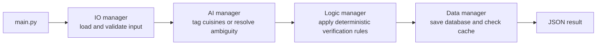

# BiteFinder Restaurant Checker (BRC)

BRC verifies restaurant halal claims against a cleaned copy of the official
MUIS eating establishment records. It can build the local MUIS database, check
one restaurant, or check a complete restaurant list. BRNS uses this service
when a search asks for halal restaurants.

## Responsibilities

BRC has two related workflows:

1. **Database build**: obtain a raw MUIS snapshot, normalize the records, add
   cuisine tags, remove duplicates, and save a searchable halal database.
2. **Restaurant check**: compare one or more restaurant records with that
   database and return the same records with official verification evidence.

BRC does not rank restaurants, calculate routes, or interact with BiteFinder
accounts. Those responsibilities belong to BRNS and BIS.

## Four manager flow



`main.py` chooses the scenario and calls the managers in this order. Manager
boundaries remain the same whether BRC runs from its menu, from the command
line, through Python, or as the Docker HTTP service.

## Files

| File | Purpose |
| --- | --- |
| `main.py` | Entry point and workflow coordinator. Provides the interactive menu and programmatic `run()` function. |
| `scraper.py` | Downloads all MUIS eating establishment records and writes the raw snapshot. It can run independently. |
| `io_manager.py` | Identifies the input scenario, validates JSON shapes, reads raw MUIS data, and prepares manager records. |
| `ai_manager.py` | Uses Gemini to tag cuisines that are not cached and to propose matches for ambiguous restaurant records. |
| `logic_manager.py` | Cleans database records and independently validates every proposed restaurant match. |
| `data_manager.py` | Owns JSON reads, atomic writes, database queries, cuisine checkpoints, and checked restaurant caches. |
| `data/` | Runtime snapshots, clean databases, resumable AI work, and verification results. |

## Input scenarios

### 1. Build or refresh the cleaned MUIS database

With no restaurant input, BRC checks for a usable raw MUIS snapshot. If one is
missing or stale, the scraper refreshes it. The snapshot then passes through
all four managers and becomes `data/halal_restaurants.json`.

Only active MUIS records categorized as eating establishments are retained.
Duplicate outlets are removed. Clean records include official certification
and source evidence. Cuisine tags are restored from the cache where possible;
only unresolved records are sent to the AI provider.

### 2. Check one restaurant

A single JSON object is compared with the clean MUIS database. BRC first uses
stable facts such as postal code, address, unit number, establishment name,
and certificate validity. An AI call is reserved for ambiguous candidate
selection, and its choice must still pass deterministic logic checks.

The resulting object includes a `muis_check` outcome. An unverified object is
never allowed to retain an `official` halal claim.

### 3. Check a restaurant list

A JSON array follows the same checking process for each item. This is suitable
for a BRNS restaurant cache or a future batch supplied by another container.
The checked list is saved and returned as one JSON result.

If the clean database does not exist when a check starts, BRC attempts to build
it before checking the supplied restaurant data.

## Running BRC

From the project root, open the interactive menu:

```bash
python -m BRC.main
```

The menu can build the database, check the default BRNS restaurant file, check
another object or array file, accept a pasted restaurant object, or load a
file containing one object.

Check a specific file without the menu:

```bash
python -m BRC.main --input BRNS/data/restaurants.json
```

Use JSON over standard input and output:

```bash
cat restaurants.json | python -m BRC.main --stdin --stdout > checked.json
```

Run only the raw data scraper:

```bash
python -m BRC.scraper
```

The standalone scraper displays its current stage, completed record count,
percentage, and current establishment. It saves progress so an interrupted
run can continue.

## Scraper completeness

The MUIS portal may cap broad query results. `scraper.py` recursively divides
the request by postal prefix and checks coverage before marking the snapshot
complete. The raw file records completeness metadata, coverage details, postal
prefixes, and the final record count. A partially proven scrape cannot silently
replace a complete database.

OneMap coordinates are cached separately so rebuilding the database does not
repeat successful geocoding. Raw snapshots are treated as fresh for up to
seven days unless a refresh is requested.

## Data directory

| File | Contents |
| --- | --- |
| `muis_establishments.json` | Raw MUIS snapshot plus scrape metadata. |
| `halal_restaurants.json` | Clean, deduplicated, searchable official halal database. |
| `cuisine_tags_cache.json` | Incremental cuisine tags keyed by stable restaurant identity. |
| `checked_restaurants_cache.json` | Reusable official check results for known outlets. |
| `checked_restaurant.json` | Most recent single restaurant result. |
| `checked_restaurants.json` | Most recent batch result. |
| `scrape_progress.json` | Resumable scraper progress. |
| `onemap_cache.json` | Coordinates already resolved during scraping. |

Writes use temporary files and atomic replacement. The data manager retries
temporary Windows file locks so a cache update does not normally fail because
an editor or scanner briefly holds the destination.

## AI use and caching

The AI manager uses Gemini with deterministic JSON output. Database builds send
uncached or unknown cuisine records in batches. Each completed batch is written
to `cuisine_tags_cache.json`; a quota failure therefore resumes from saved work
instead of tagging every restaurant again.

Matching AI output is treated as a proposal. `logic_manager.py` still requires
consistent outlet evidence, including brand similarity, address or postal
evidence, compatible unit information, and a valid certificate. This prevents
an AI response from granting official status by itself.

Relevant environment variables are:

| Variable | Purpose |
| --- | --- |
| `GEMINI_API_KEY` | Gemini credential used by the BRC AI manager. |
| `BRC_GEMINI_MODEL` | Model selected for BRC requests. |
| `BRC_AI_REQUEST_INTERVAL_SECONDS` | Minimum pacing delay between requests. |
| `BRC_AI_BATCH_SIZE` | Number of cuisine records sent in one tagging request. |
| `BRC_AI_TIMEOUT_SECONDS` | Provider request timeout. |

Rate limit responses are retried with provider delay information when
available. Persistent provider failure stops the affected build or ambiguous
check with a clear error; completed cuisine batches remain cached.

## Docker integration

Docker Compose runs BRC as its own private service. It exposes internal health,
status, and restaurant check endpoints to the BRNS container. BRNS uses a
remote adapter and does not need to import the container's files. The named
`brc-data` volume preserves the MUIS snapshot and caches across restarts.

Build the database inside the running service with:

```bash
docker compose exec brc python -m BRC.main
```

## Testing

Run the focused checker tests:

```bash
python -m unittest tests.test_brc_checker -v
```

The tests cover database building, deterministic matching, rejection cases,
cache behavior, input shapes, and BRNS integration boundaries without relying
on a live MUIS, OneMap, or Gemini request.

See [ProjectFlow.md](../ProjectFlow.md) for BRC's place in the complete
BiteFinder flow.

