# BiteFinder Data Flow

This document maps the current CLI/web application to its record formats,
stores, and trust boundaries. See [ProjectFlow.md](ProjectFlow.md) for control
flow and [README.md](README.md) for operation commands.

## Context and subsystem boundaries

```mermaid
flowchart LR
  user["CLI or browser user"]
  http["HTTP gateway for browser requests"]
  bis["BIS&#58; accounts, profiles, chat, search"]
  brns["BRNS&#58; recommendations, routes, history"]
  brc["BRC&#58; independent MUIS verifier"]
  ai["Configured AI providers"]
  google["Google Maps Platform"]
  smtp["SMTP service"]
  muis["MUIS directory and OneMap"]
  mongo["MongoDB domain collections"]
  json["BRC raw, cleaned, and checked JSON"]
  user -->|CLI input| bis
  user -->|Browser HTTP| http
  http -->|Transport payload| bis
  bis -->|Validated request JSON| brns
  brns -->|Restaurant object or batch| brc
  bis -->|Interpretation tasks| ai
  brns -->|Candidate ranking| ai
  brc -->|Optional tagging or ambiguous match| ai
  google -->|Origin coordinates| bis
  google -->|Place and route facts| brns
  bis -->|OTP or CLI Maps link| smtp
  muis -->|Official listings and geocodes| brc
  bis -->|Identity and user state| mongo
  brns -->|Restaurant facts and history| mongo
  brc -->|Official evidence and check results| json
  brc -->|Checked records| brns
  brns -->|Results and routes| bis
  bis -->|Formatted output| user
```



Browser transport is `frontend/` → nginx → `http_gateway/` → BIS web IO.
BIS calls the headless `BRNSService` contract; BRNS owns BRC integration.
CLI uses BIS directly and can operate without the HTTP gateway or nginx.
Compose configures both CLI and API to share MongoDB. BRC's independent store
continues to use JSON files.

## Identity and profile records

The persisted BIS user schema is:

```text
userID: string
email: normalized string
email_verified: boolean
username: string or null
preferences:
  location: list of strings or null
  max_distance_km: number or null
  max_travel_time_minutes: number or null
  budget_per_person: number or null
  dietary_requirements: list or null
  liked_cuisines: list or null
  disliked_cuisines: list or null
  other_preferences: list or null
```

`users` uses `_id=userID` in MongoDB. Stores remove backend metadata before
returning a domain user. Web IO formats public responses as `user_id`, account
fields, and flattened preference fields. Passwords are not public profile fields.

New passwords are 8–128 characters. `PasswordHasher` uses a random salt and
PBKDF2-SHA256; MongoDB `web_credentials` or JSON `credentials.json` stores the
salt/hash separately. CLI and web consult the same Mongo credential collection.

With SMTP bypass disabled, a verification challenge contains a salt, code hash,
sent/expiry timestamps, attempts, and attempt-window start. Pending web
enrollment is stored separately in `profile_state`. After email proof, pending
credentials can be saved and a session issued. `SMTP_BYPASS=true` also enables
the web bypass and must not be represented as email ownership proof.

Web sessions return a random bearer token while persisting its SHA-256 digest.
Explicit expiry checks enforce session validity; a TTL index provides cleanup.
Favorites and history are scoped to the authenticated user's ID. Requests with
another user's profile ID are rejected.

## Search request contract

BIS serializes this exact ten-field contract for each BRNS search:

```json
{
  "origin": {
    "query": "Tampines",
    "label": "Tampines, Singapore",
    "latitude": 1.35,
    "longitude": 103.94
  },
  "mode": "walk",
  "max_distance_km": null,
  "max_travel_minutes": 20,
  "traffic_aware": false,
  "cuisine": "japanese",
  "budget_per_person": 20,
  "other_preferences": [],
  "dietary_requirements": [],
  "disliked_cuisines": []
}
```

The coordinates above are illustrative input, not a geocoding result. Exactly
one travel limit is active; transit requires time, and traffic awareness is
limited to driving-time requests. BRNS revalidates the schema at its IO boundary.

The web HTTP schema adds `location`, `locations`, `liked_cuisines`,
`confirm_only`, and `confirmation_token`; these transport fields are not extra
BRNS fields. BIS resolves multiple origins to a midpoint and converts multiple
cuisines/custom terms into individual validated requests and merge policy.
Results retain `input_origins`, selected cuisines, and a cuisine breakdown.

Direct web search is the default. `confirm_only=true` persists a proposal with
a ten-minute expiry and owner-bound token digest; consuming the token selects
the saved request. Tokens are one-use. Guests use an opaque token with a null
owner. Chat confirmation updates browser state before a direct form search;
it does not imply that every search uses a stored proposal token.

## AI and restaurant trust states

```mermaid
flowchart TB
  raw["Raw Places record or saved restaurant"]
  normalized["Candidate with route and opening facts"]
  context["Logic-prepared prompt with numeric IDs"]
  reply["Untrusted AI JSON"]
  schema["AI Manager&#58; schema and ID validation"]
  verify["BRC evidence when halal requested"]
  logic["Logic&#58; grounded reasons and domain rules"]
  data["Data&#58; normalized facts and history summary"]
  output["BIS IO&#58; result representation"]
  error["Stop without completed search summary"]
  raw --> normalized
  normalized --> context
  context -->|AI provider| reply
  reply --> schema
  schema -->|Valid| verify
  schema -->|Invalid or unavailable| error
  verify --> logic
  logic -->|Evaluated results| data
  logic -->|Matches, alternatives, exclusions| output
```



BRNS AI receives Logic-prepared candidate facts, numeric IDs, request limits,
rating context, and previous result names. Its structured response is:

```json
{"recommendations": [{"id": 0, "reason_codes": ["within_budget", "within_route"]}]}
```

Every candidate ID must occur exactly once. Logic grounds reason codes against
facts; unsupported claims are not displayed as facts. The domain outcome
policy classifies each candidate, independently of a model's preference.

BRC receives a restaurant object or batch, finds MUIS candidates, and validates
outlet/certificate identity after an exact match or AI proposal. Official MUIS
evidence remains separate from Google halal hints. Cached, keyword-derived,
and exact-match BRC records can skip AI; Compose also disables AI cuisine
batch building. Chat can use deterministic fallback parsing. No diagram here
claims that all records or all account operations make live AI calls.

## Persistence ownership

| Store | Data and owner |
| --- | --- |
| MongoDB `users` | BIS identity and nested preferences |
| `web_credentials` | BIS salted password hashes shared by CLI/web |
| `profile_state` | BIS verification, pending authentication, display and search state |
| `sessions` | Expiring web session digests |
| `search_proposals` | One-use interpreted-search proposals and token digests |
| `favorites` | User ID, place key, and bookmarked restaurant payload |
| `restaurants` | BRNS normalized restaurant facts, keyed by Google place ID |
| `search_history` | BRNS user-scoped request/result counts and summary metadata |
| `geocode_cache` | Common normalized query aliases and validated coordinates |
| `BRC/data/muis_establishments.json` | BRC raw official snapshot |
| `BRC/data/halal_restaurants.json` | BRC cleaned active outlet database |
| `BRC/data/cuisine_tags_cache.json` | BRC resumable cuisine tags |
| `BRC/data/checked_restaurants_cache.json` | BRC accumulated checked outlet records |
| `BRC/data/checked_restaurant.json`, `checked_restaurants.json` | BRC latest single/batch output |
| BRC scrape progress and OneMap cache | BRC collection checkpoints and geocodes |

Restaurant documents include `google_place_id`, name/address/contact fields,
Google rating/review count, cuisine/dietary data, price range, weekly hours,
accessibility, halal status, and coordinates. Later missing values do not
necessarily erase earlier known values. Current route facts are recomputed for
the search origin rather than treating saved durations as live routes.

### JSON mode, synchronization, and migration

The interactive CLI sets Mongo mode by default unless `BITEFINDER_STORAGE` is
already set. Selecting `json` explicitly uses `BIS/data/users.json`,
`profile_state.json`, `credentials.json`, configured BRNS restaurant/history
JSON paths, and `data/geocode_cache.json`. The web runtime requires MongoDB;
JSON mode is not an automatic outage fallback.

`CliUserFileSync` exists as an optional Data Manager collaborator. Current CLI
and web composition roots do not inject it, so normal operation does not imply
automatic two-way JSON/Mongo synchronization. `BRNS/runtime.py` can seed an empty
restaurant collection if an optional JSON catalog exists and
`BITEFINDER_AUTO_SEED` is not disabled; the repository does not ship that catalog.

`common/migrate_to_mongo.py` explicitly validates selected JSON exports. It
prints counts without connecting by default; writes require `--apply` and an
exact `--confirm-database` match. It preserves IDs and refuses conflicting
existing records. It does not migrate arbitrary old web database schemas,
BRC's authoritative files, or credentials into public user records.

## Docker volumes and logs

- `mongo-data` stores the Mongo database under `/data/db`.
- `api` and `bis-brns` share `application-data`; Dockerfile symlinks map their
  BIS/BRNS scratch files and `/app/logs` into `/data`.
- `brc-data` maps BRC `/data`, including MUIS data and BRC's own logs.
- `logs/bitefinder.log` is a common relative path, not one file shared across
  every container. Trace IDs propagated over HTTP correlate separate logs.
- Frontend assets are copied into the nginx image; source edits need a rebuild.

Normal `docker compose --profile "*" down` preserves named volumes. Adding
`-v` deletes their saved records. Browser local storage holds the bearer token,
recent-query state, and UI preferences; it is not the authoritative Mongo store.
