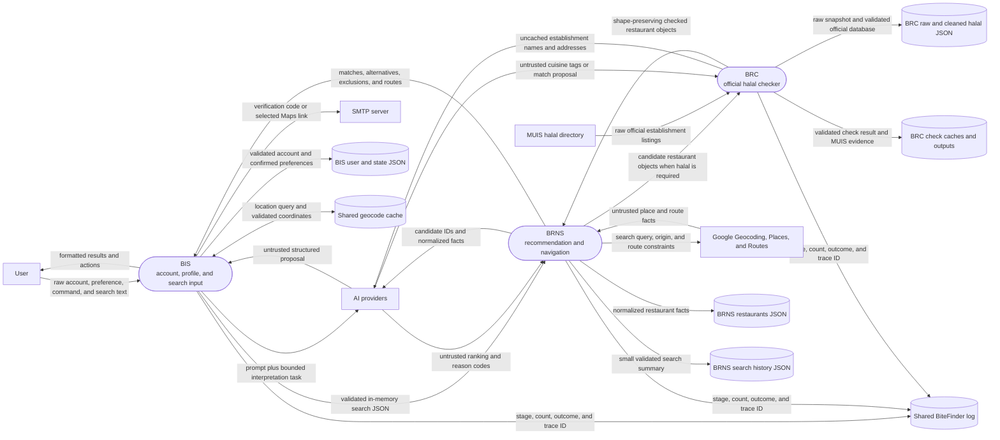
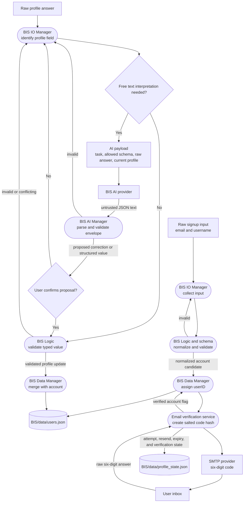
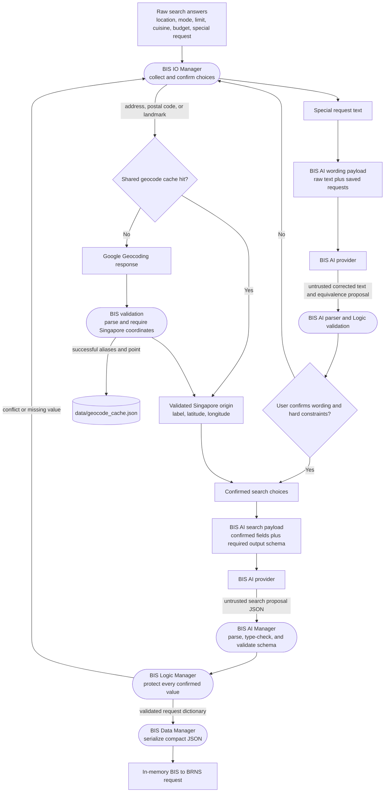
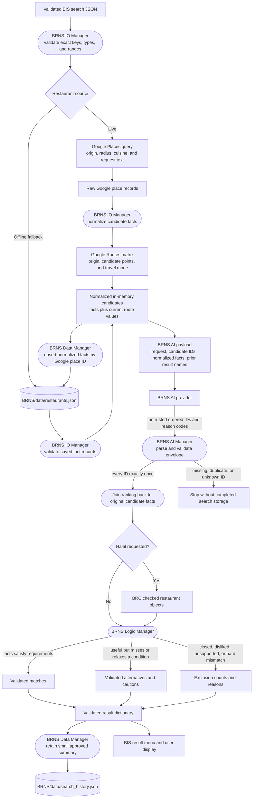
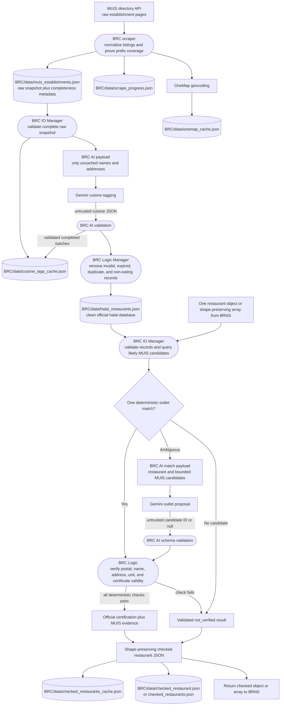
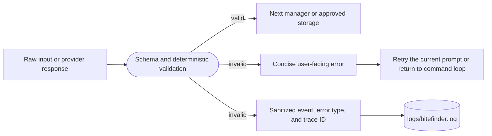

# BiteFinder Data Flow Diagram

This document shows how BiteFinder data changes shape and trust state as it
moves from user input through BIS, AI providers, BRNS, BRC, external fact
providers, and JSON storage.

For control flow and decision branches, see [ProjectFlow.md](ProjectFlow.md).
The diagrams below focus on **what data enters a process, how it is transformed,
and where the validated result is stored**.

## Diagram notation

| Shape or label | Meaning |
| --- | --- |
| Rectangle | Person, external provider, or another BiteFinder subsystem |
| Rounded process | A manager that transforms or validates data |
| Cylinder | Durable JSON file, cache, or log |
| `raw` | Untrusted text or provider response |
| `proposed` | Parsed structure that still requires validation |
| `validated` | Structure accepted by deterministic application rules |
| `persisted` | Validated structure written to durable storage |

## Level 0: complete project data flow

The AI providers never receive authority to write files directly. Their output
returns to the calling AI manager, then passes through schema checks, business
logic, and sometimes user confirmation before a data manager can persist it.

## Level 1: BIS account and profile data

### Profile state transformation

| Stage | Example | State |
| --- | --- | --- |
| User input | `wesaten italian` | Raw text; not saved |
| AI request | Task, supported cuisine list, current values, and raw text | Bounded interpretation payload |
| AI response | `{"cuisines":["Western","Italian"]}` | Proposed and untrusted |
| User confirmation | User accepts corrected cuisines | Confirmed proposal |
| Logic result | Unique supported cuisines with liked/disliked conflicts removed | Validated profile value |
| Data write | Value merged into the account keyed by `userID` | Persisted in `BIS/data/users.json` |

Simple values still pass through validation even when no AI call is needed.
Declined corrections and invalid provider responses are not persisted.

## Level 1: search request and AI payloads

The BIS-to-BRNS request is a transient JSON message rather than a BIS profile
file. It contains the confirmed origin, travel mode and limit, traffic setting,
cuisine, budget, dietary requirements, disliked cuisines, and other
preferences. BRNS validates the complete message again at its IO boundary.

## Level 2: BRNS recommendation data

BRNS sends candidate facts to the model with small numeric identifiers. The
model returns ordering and controlled reason codes, not replacement restaurant
facts. BRNS joins the IDs back to the original candidates and checks each reason
against the factual record before displaying it.

### Restaurant fact transformation

| Stage | Data form | Storage effect |
| --- | --- | --- |
| Google response | Provider-specific place, rating, review, price, hours, and accessibility fields | None; untrusted |
| Normalized candidate | Stable internal keys, parsed numbers, coordinates, cuisines, dietary hints, and routes | In memory |
| AI ranking | Candidate IDs in order plus controlled reason codes | In memory; untrusted until validated |
| Logic result | Match, alternative, or exclusion with grounded reasons | In memory; validated |
| Restaurant upsert | Public fact fields keyed by `google_place_id`; earlier known values retained when a later response omits them | `BRNS/data/restaurants.json` |
| Search summary | Source, origin coordinates, travel mode, cuisine, and top IDs or names | `BRNS/data/search_history.json` |

Raw Google responses, raw prompts, and raw AI responses are not copied into the
restaurant or search-history files.

## Level 2: BRC database and verification data

Cuisine AI work is checkpointed after completed batches. If a provider quota
is exhausted, the next database build loads the saved tags and submits only
remaining records. An AI outlet match is only a proposal; deterministic BRC
Logic must verify the exact outlet before certification becomes `official`.

## Durable data stores

| Store | Writer | Stored state | Primary reader |
| --- | --- | --- | --- |
| `BIS/data/users.json` | BIS Data | Accounts, verification flag, and saved profile preferences | BIS |
| `BIS/data/profile_state.json` | BIS Data and email verification service | Verification challenge, display preference, and other per-user session state | BIS |
| `data/geocode_cache.json` | Shared geocode cache | Normalized query aliases mapped to validated coordinates | BIS and BRNS |
| `BRNS/data/restaurants.json` | BRNS Data | Normalized restaurant facts and offline fallback records | BRNS |
| `BRNS/data/search_history.json` | BRNS Data | Approved compact search summaries | BRNS repeat/history logic |
| `BRC/data/muis_establishments.json` | BRC scraper/Data | Raw normalized MUIS snapshot and completeness proof | BRC database build |
| `BRC/data/halal_restaurants.json` | BRC Data | Clean deduplicated official halal establishments | BRC checker |
| `BRC/data/cuisine_tags_cache.json` | BRC Data | Completed cuisine tags keyed by stable establishment identity | BRC AI/database build |
| `BRC/data/checked_restaurants_cache.json` | BRC Data | Reusable outlet verification outcomes | BRC checker |
| `BRC/data/checked_restaurant.json` | BRC Data | Most recent single checked object | Developer or integration consumer |
| `BRC/data/checked_restaurants.json` | BRC Data | Most recent checked array | Developer or integration consumer |
| `BRC/data/scrape_progress.json` | BRC scraper/Data | Completed and pending postal-prefix work | BRC scraper resume |
| `BRC/data/onemap_cache.json` | BRC scraper/Data | MUIS outlet geocoding results | BRC scraper |
| `logs/bitefinder.log` | Shared logger | Timestamp, severity, trace ID, event, and concise outcome | Developers and operators |

Application JSON writes use their owning data boundary. Critical account, BRC,
and shared-cache writes use temporary files and atomic replacement so a failed
write retains the previous valid file where supported.

## Data that remains transient

The following data is used in memory and is not intentionally stored as a
complete durable record:

- plaintext SMTP verification codes;
- raw AI prompts and raw provider response bodies;
- API keys and SMTP passwords;
- the complete serialized BIS-to-BRNS request;
- complete Google Places and Routes response bodies;
- rejected AI proposals;
- full user conversations; and
- route results that have not been selected for display.

The shared log stores operational stages, counts, error types, and trace IDs.
It must not contain credentials, verification codes, complete provider bodies,
email addresses, or full private user input.

## Failure-state data flow

Invalid or incomplete data does not advance to the next trust state. A failed
BIS AI proposal does not call BRNS. Invalid BRNS ranking does not create a
completed search summary. An unverified BRC proposal does not grant official
halal status. Existing valid files remain the fallback when an atomic update
cannot be completed.

