# BiteFinder Project Flow

This is the current application workflow on `WEB-OOP`. BiteFinder has two BIS
user interfaces over the same recommendation subsystem: an interactive Python
CLI and a browser interface served by nginx and FastAPI. BRC remains an
independent HTTP microservice in Compose.

For setup and shutdown commands, see [README.md](README.md). For record shapes,
storage, and trust boundaries, see [DataFlowDiagram.md](DataFlowDiagram.md).

## Entry points and subsystem boundaries

```mermaid
flowchart TB
  launch["main.py or BIS/main.py"]
  choice["BISLauncher&#58; CLI, Web, or Exit"]
  cli["BIS CLI&#58; accounts, profiles, search"]
  browser["Browser&#58; filters, chat, results"]
  nginx["nginx web container"]
  http["http_gateway&#58; HTTP routes and lifespan"]
  bis["BIS runtime and web IO"]
  brns["BRNSService gateway"]
  brc["Independent BRC HTTP service"]
  exit_app["Exit launcher"]
  launch --> choice
  choice -->|CLI or --cli| cli
  choice -->|Web or --web| browser
  choice -->|Exit| exit_app
  browser -->|HTTP on localhost&#58;8080| nginx
  nginx -->|Proxy /api/| http
  http -->|BIS only| bis
  bis -->|Search, route, history| brns
  cli -->|Confirmed search JSON| brns
  brns -->|Halal verification| brc
```



- `python main.py` and `python BIS/main.py` offer CLI, Web, or Exit. Enter
  selects CLI; `--cli` and `--web` select a mode without the menu.
- The host web launcher checks readiness, starts/reuses Compose when needed,
  and attempts to open the browser. Inside a container it checks the web service
  and displays the host URL; it does not launch Docker or a host browser.
- Browser calls enter `http_gateway/routes.py`, which delegates to BIS web IO.
  `http_gateway/dependencies.py` delegates construction to `BIS/runtime.py`.
- BIS uses `BRNSGatewayInterface` through `BRNSService`, built by
  `BRNS/runtime.py`. HTTP route handlers do not directly invoke BRNS or BRC.
- BRNS uses the BRC adapter for halal verification. Compose supplies
  `BRC_SERVICE_URL=http://brc:8000`; the host CLI can use in-process BRC when
  that variable is absent.
- Direct BRNS/BRC command-line entry points are maintenance/test paths gated
  by `--internal` or `BITEFINDER_INTERNAL_CLI=1`.

## Accounts and saved profiles

1. Signup collects a normalized email, username, and a password of 8–128
   characters. Resume/login verifies the stored password. CLI password changes
   are available through `/password`.
2. CLI and web share MongoDB `users` and `web_credentials` in normal operation.
   Existing accounts without credentials follow password enrollment.
3. With `SMTP_BYPASS=false`, authentication sends a six-digit email challenge.
   The challenge tracks expiry, resend cooldown, and failed attempts; successful
   verification consumes it. Web login returns an expiring bearer session.
4. `SMTP_BYPASS=true` skips email/OTP verification in **both CLI and web**.
   The web bypass can enroll legacy credentials and mark an account verified;
   that flag is a testing shortcut, not evidence of inbox ownership.
5. CLI resumes incomplete profiles field by field, interprets free text when
   needed, and validates updates before saving. A complete profile opens the
   command loop and may trigger the first guided search.
6. Web supports a profile form and chatbot onboarding. Chat replies update
   filters, ask for missing values, and can save preferences for a signed-in
   user. Ordinary filter edits are not automatically a saved profile update.

## Search and recommendation

```mermaid
flowchart TB
  input["BIS IO&#58; CLI choices or web filters"]
  bisai["BIS AI&#58; interpret search request"]
  bislogic["BIS Logic&#58; validate confirmed choices"]
  bridge["BRNSService gateway"]
  facts["BRNS IO&#58; Places, saved facts, Routes"]
  rank["BRNS AI&#58; candidate IDs and reason codes"]
  brc["BRC&#58; official evidence if halal requested"]
  rules["BRNS Logic&#58; grounded reasons and outcome policy"]
  save["BRNS Data&#58; facts and history"]
  results["BIS IO&#58; CLI results or web response"]
  error["Show error or request clarification"]
  input -->|Resolved Singapore origins| bisai
  bisai -->|Structured proposal| bislogic
  bislogic -->|Direct web search or confirmed proposal| bridge
  bislogic -->|Conflict or invalid response| error
  bridge -->|One call per web cuisine| facts
  facts -->|Usable candidates| rank
  rank -->|Valid ranking| brc
  rank -->|Provider or schema failure| error
  brc -->|Verified or explicitly unofficial evidence| rules
  rules -->|Evaluated results| save
  save -->|Merged web results or CLI result set| results
```



### CLI collection

BIS collects one Singapore origin, walk/drive/transit mode, one active distance
or time limit, traffic awareness for driving-time searches, one cuisine or
`none`, budget, dietary requirements, dislikes, and special wishes. It can
review spelling and hard-constraint wording with AI and ask for clarification.
The interpreted request is confirmed before the BRNS handoff. `AI_BYPASS=true`
is a CLI test path that displays the validated request and skips BRNS.

### Browser search and chat

The web form supports multiple starting locations and selected/custom cuisine
terms. BIS Logic computes a midpoint search origin from resolved locations.
For multiple cuisines, BIS runs separate BRNS searches, merges/deduplicates
results through Logic, and saves a combined user history summary. The web path
requests up to 20 matches and 20 alternatives per BRNS call; multi-cuisine
merging uses a total cap of 20.

`POST /api/search` runs directly by default. Sending `confirm_only=true`
creates a stored proposal and returns `confirmation_required=true` with a
one-use `confirmation_token`; a later token submission uses the stored request.
The regular form currently submits direct searches. Chat uses `/api/chat` to
clarify filters and asks for confirmation before triggering the form search;
that conversational confirmation is separate from the proposal-token API.

### BRNS decisions

BRNS validates the exact ten-field BIS request, gathers live Google Places and
Routes facts or configured saved records, and asks its AI pipeline to rank the
candidate IDs. Logic verifies IDs/reasons against candidate facts, applies
cuisine, dietary, price, travel, opening, and rating rules, and separates
matches, alternatives, and exclusions. Restaurant facts and history are saved
through Data before the result returns to BIS.

Read/validation work and external fact gathering occur before AI; the diagram
shows the main recommendation flow, not a rule that every manager call must
occur exactly once. Cached/local BRC paths and chatbot fallbacks also exist;
this document does not assert that every operation invokes an AI API.

## BRC verification and database preparation

BRC's HTTP service exposes `/health`, `/status`, and `/check`. A check accepts
one restaurant object or an array and preserves that response shape.

- Missing cleaned data triggers a build from a usable raw MUIS snapshot or a
  scrape. The server also starts a background warm-up when data is missing,
  unless `BRC_AUTO_WARM=0`. Healthy HTTP does not mean the dataset is ready.
- Build logic reuses cuisine caches and keyword tags. Compose explicitly sets
  `BRC_BUILD_CUISINES_WITH_AI=0`; optional AI batch tagging is therefore skipped
  in its normal build configuration. Ambiguous outlet checks can still use AI.
- Exact matches/no-candidate cases can skip AI. AI proposals never establish
  official certification by themselves: Logic checks outlet identity and MUIS
  certificate evidence.
- BRNS can batch candidate checks through its adapter. Verified results become
  `official`; Google halal indications remain explicitly `unofficial` when
  official checking is unavailable or inconclusive. Missing evidence is not
  converted into official verification.
- BRC persists raw/cleaned JSON, cuisine and check caches in its own volume.

## Result actions

| Interface | Available interaction |
| --- | --- |
| CLI | Details, rating/distance sorting, route, Maps-link email, alternatives, refine choices, repeat with previous results, finish/logout |
| Browser | Filters/chat, result cards and sorting, map and route drawer, up to three restaurants in comparison, authenticated favorites, profile and search history |

Navigation returns available route details and a Google Maps link. Sorting and
browser comparison use existing result facts; they do not establish new
certification or replace domain eligibility decisions.

## Deployment and lifecycle

```mermaid
flowchart LR
  browser["Host browser"]
  web["web&#58; nginx on localhost&#58;8080"]
  api["api&#58; FastAPI, BIS, and BRNS"]
  cli["bis-brns&#58; BIS CLI and BRNS"]
  db["mongodb on localhost&#58;27017"]
  admin["mongo-express on localhost&#58;8081&#59; dev profile"]
  brc["brc&#58; independent HTTP service"]
  mongo["mongo-data volume"]
  app["application-data volume"]
  brcdata["brc-data volume"]
  browser -->|Website| web
  web -->|Internal port 8000| api
  browser -->|Optional admin UI| admin
  admin -->|Mongo connection| db
  api -->|Accounts and recommendation stores| db
  cli -->|Same database| db
  api -->|Internal HTTP| brc
  cli -->|Internal HTTP| brc
  db -->|Durable database| mongo
  api -->|Scratch files and logs| app
  cli -->|Shared application volume| app
  brc -->|MUIS files and separate logs| brcdata
```



All Compose services use `bitefinder-web`. Only nginx (`8080`), optional
mongo-express (`8081`), and MongoDB (`27017`) publish loopback host ports.
API and BRC each use internal port `8000` in separate containers.

```powershell
# Start the runtime stack.
docker compose up -d --build
# Optionally enable MongoDB administration.
docker compose --profile dev up -d mongo-express
# Open the CLI.
docker compose exec bis-brns python main.py --cli
# Stop every profile and preserve saved data.
docker compose --profile "*" down
```

Closing the browser or leaving the CLI does not stop shared services. Plain
`docker compose down` can leave mongo-express running because its `dev` profile
is inactive, keeping the network in use. Adding `-v` intentionally deletes
saved named volumes; it is not part of normal shutdown.

`api` and `bis-brns` share `application-data`; BRC uses `brc-data`, including
its own log file. Trace IDs connect operations across HTTP, but there is no
single log volume shared by all containers.

## Failure paths

| Failure | Current outcome |
| --- | --- |
| Bad CLI input or declined correction | Explain/re-prompt or cancel without applying that update |
| Provider/schema failure in required recommendation processing | Return an error rather than fabricate ranked results |
| Chat AI unavailable | Recognized deterministic chat parsing can still update filters or ask clarification |
| No open restaurants in the web search path | Empty results with an explanatory message for recognized no-open errors |
| Invalid/expired/used search token | Reject and require a new proposal |
| BRC unavailable | Summarize failure; retain only clearly labelled available evidence |
| MongoDB unavailable | Explicit unavailable error, without automatic switch to JSON |
| Missing/corrupt JSON | Store-specific handling; BIS protects invalid account files, BRNS can return empty collections |
| SMTP unavailable with bypass disabled | Report delivery failure; no successful email proof is invented |

See subsystem READMEs for implementation paths and the [test guide](tests/README.md)
for deterministic fixtures covering these boundaries.
