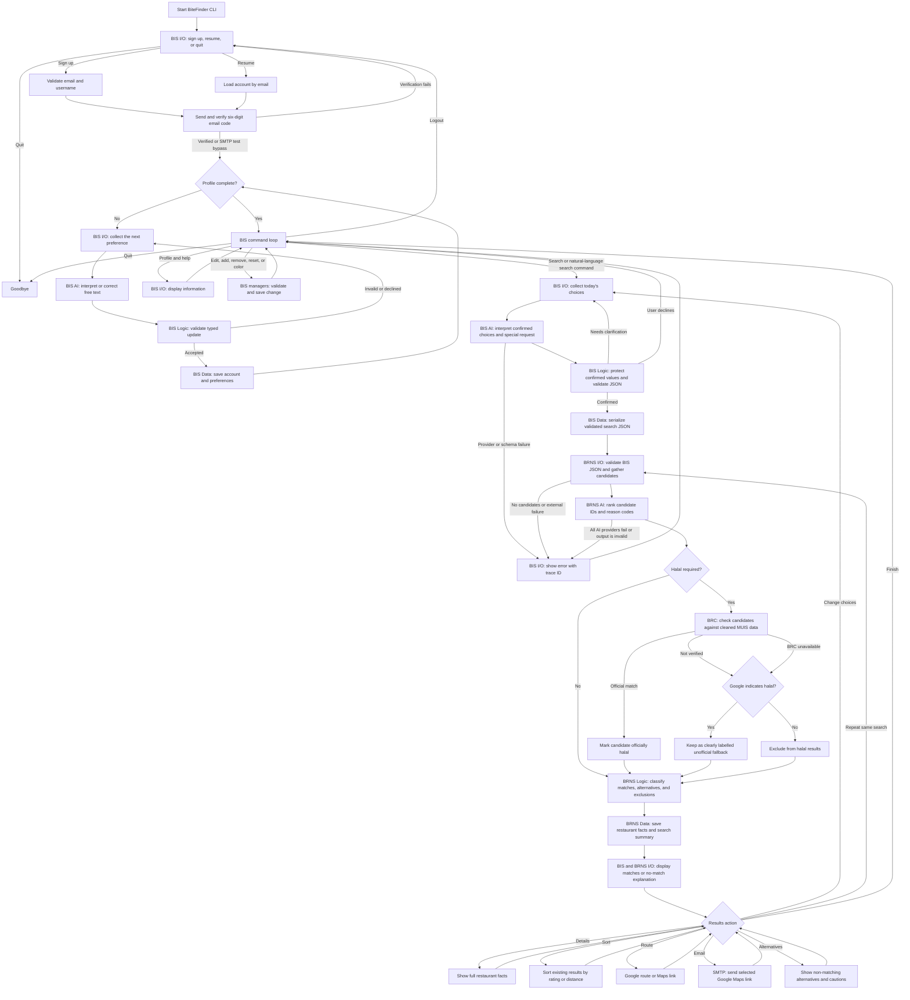
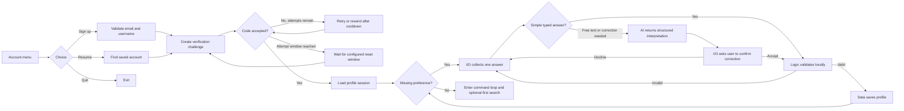
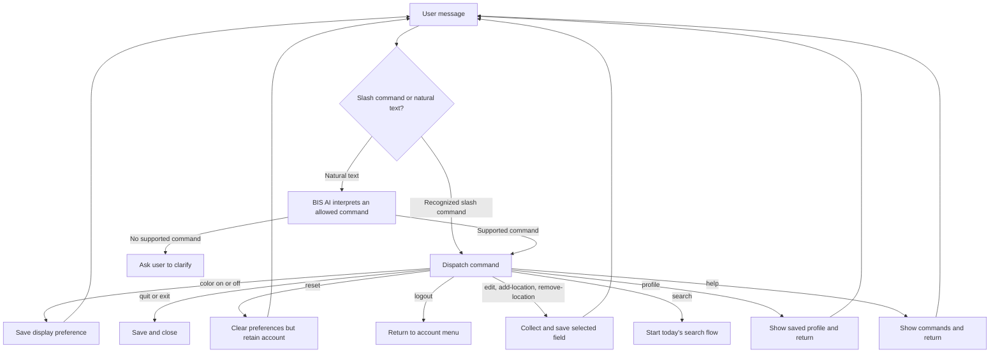
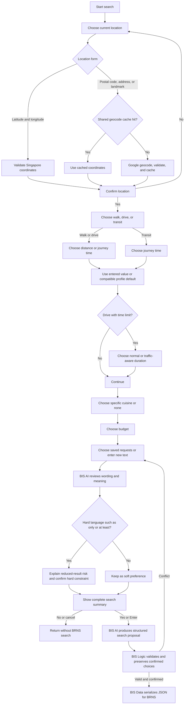
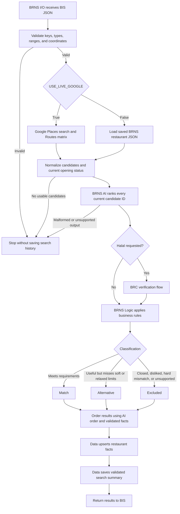
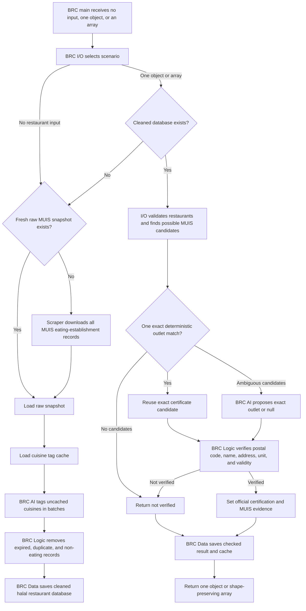
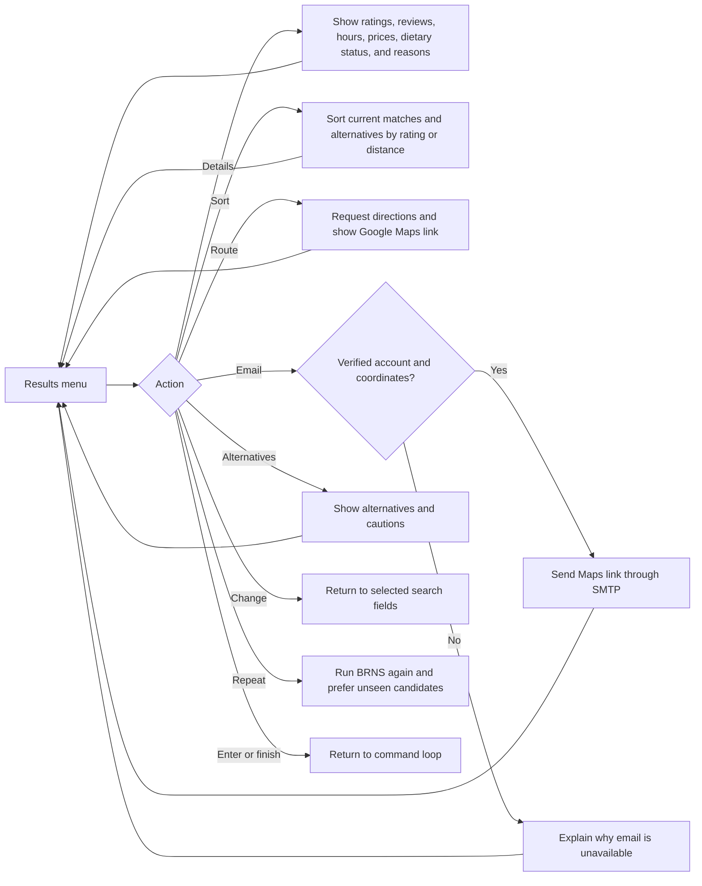
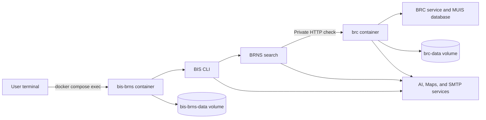

# BiteFinder Project Flow

This document shows the complete BiteFinder workflow and its major decision
branches. BiteFinder consists of three procedural applications:

- **BIS** collects accounts, profiles, and today's search request.
- **BRNS** finds, ranks, filters, and routes to restaurants.
- **BRC** builds a cleaned MUIS dataset and verifies halal candidates.

## Complete application flow

## BIS account and profile branches

Saved profile fields are locations, distance and time estimates, budget,
dietary requirements, liked cuisines, disliked cuisines, and reusable special
requests.

## BIS command branches

`/help` and color commands are available while other questions are active and
return the user to the same prompt.

## Search collection and BIS handoff

## BRNS recommendation branches

BRNS grounds every displayed AI reason in candidate facts. Unsupported reason
codes are removed and written to the shared log rather than shown as facts.
Ratings use both the Google score and review count. Live candidates must have
usable current opening information before they can be recommended.

## BRC workflow branches

BRC can run interactively, accept `--input`, read `--stdin`, or be called by
BRNS. In Docker Compose, BRNS calls the dedicated BRC container through its
private HTTP service.

## Result-action branches

## Failure and fallback paths

| Failure | Behavior |
| --- | --- |
| Invalid user answer | BIS I/O explains the accepted form and repeats the same prompt. |
| AI wording correction declined | The original value is not changed or saved. |
| All BIS AI providers fail | Search interpretation stops; BRNS is not called. |
| Invalid BIS search JSON | BRNS rejects the request before Places, AI ranking, or history saving. |
| Google live search disabled | BRNS loads `BRNS/data/restaurants.json`, while BRNS AI ranking remains required. |
| Google or route request fails | The search stops or reports unavailable route facts; route values are not invented. |
| BRNS AI fails or returns invalid IDs | Recommendation stops and no completed search summary is saved. |
| BRC database missing | BRC tries to build it from the raw MUIS snapshot or scraper before checking. |
| BRC unavailable during halal search | Google-indicated halal candidates may continue only as unofficial fallback results. |
| Missing or corrupt saved JSON | The responsible data boundary logs or reports the error and protects existing data. |
| SMTP delivery fails | The account or search session remains usable and the user receives an error. |

## Docker deployment flow

The two containers share the private `bitefinder-net` network. The `brc`
container exposes its health and checking service only inside that network.
Named volumes retain application JSON, caches, and logs across container
replacement.

## Main persisted data

| Path or volume area | Purpose |
| --- | --- |
| `BIS/data/users.json` | Accounts and saved profile preferences |
| `BIS/data/profile_state.json` | Search, verification, and display state |
| `BRNS/data/restaurants.json` | Saved Google restaurant facts and offline fallback |
| `BRNS/data/search_history.json` | Validated search summaries |
| `BRC/data/muis_establishments.json` | Raw MUIS scrape snapshot |
| `BRC/data/halal_restaurants.json` | Cleaned official halal database |
| `BRC/data/cuisine_tags_cache.json` | Resumable cuisine tags |
| `BRC/data/checked_restaurants_cache.json` | Previous outlet checks |
| `data/geocode_cache.json` | Shared successful geocoding results |
| `logs/bitefinder.log` | Shared traceable operational log |

