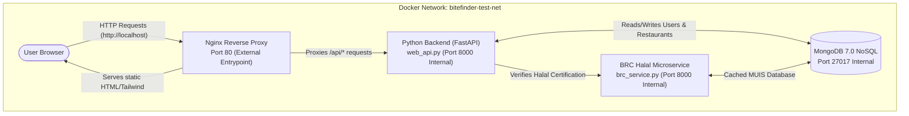

# BiteFinder Web & NoSQL Architecture

This document contains the complete system architecture diagram for BiteFinder's new web server, reverse proxy, and MongoDB NoSQL setup.

---

## 1. System Architecture Diagram



---

## 2. Container Network & Port Mapping

| Service | Container Name | Internal Port | Host / External Port | Purpose |
| :--- | :--- | :--- | :--- | :--- |
| **Nginx** | `bitefinder-test-web` | 80 | **80** | API Gateway & static frontend server |
| **FastAPI** | `bitefinder-test-api` | 8000 | *Isolated (internal)* | Executes BIS & BRNS business logic |
| **BRC** | `bitefinder-test-brc` | 8000 | *Isolated (internal)* | Official MUIS Halal verification service |
| **MongoDB** | `bitefinder-test-mongodb` | 27017 | **27017** | NoSQL database storing users, restaurants, geocache |

---

## 3. Raw Mermaid Code (For Slides & Documentation)

You can copy the raw Mermaid code below and paste it directly into:
- [Mermaid Live Editor](https://mermaid.live) to download as **PNG** or **SVG** for your presentation slides.
- GitHub Markdown preview.
- Notion, Obsidian, or draw.io.

```text
flowchart TD
    User([User Browser])
    
    subgraph Docker ["Docker Network: bitefinder-net"]
        Nginx["Nginx Reverse Proxy<br/>Port 80 (External Entrypoint)"]
        
        API["Python Backend (FastAPI)<br/>web_api.py (Port 8000 Internal)"]
        BRC["BRC Halal Microservice<br/>brc_service.py (Port 8000 Internal)"]
        DB[("MongoDB 7.0 NoSQL<br/>Port 27017 Internal")]
        
        Nginx -->|"Serves static HTML/Tailwind"| User
        Nginx -->|"Proxies /api/* requests"| API
        API <-->|"Reads/Writes Users & Restaurants"| DB
        API -->|"Verifies Halal Certification"| BRC
        BRC <-->|"Cached MUIS Database"| DB
    end

    User -->|"HTTP Requests (http://localhost)"| Nginx
```

